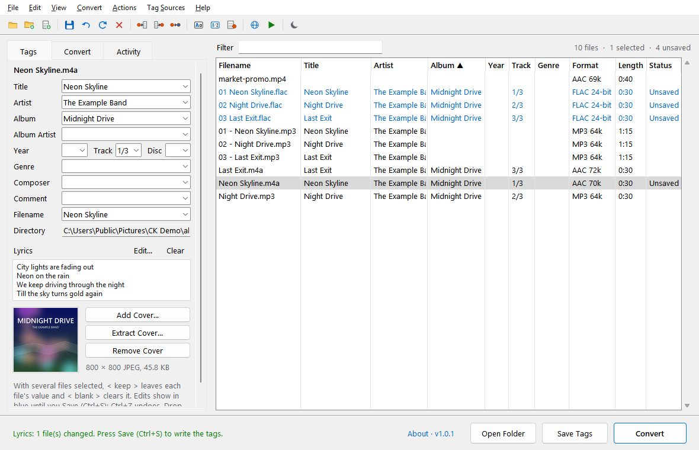
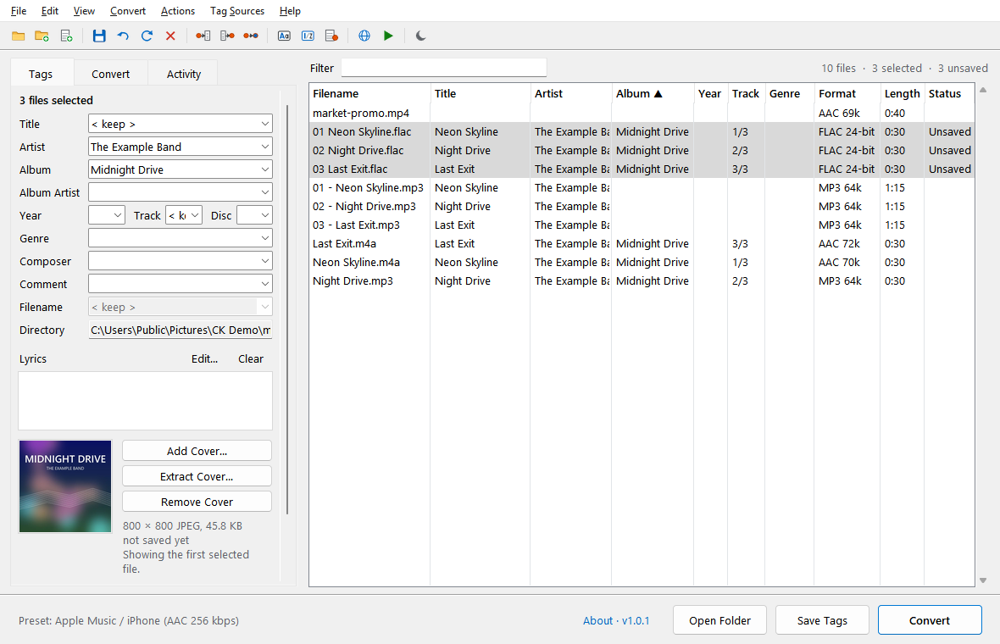

<p align="center">
  
</p>

<h1 align="center">CK Music Converter</h1>

<p align="center">
  A music tagger and audio converter in one, for Windows.<br>
  Fix the tags, lyrics and cover art of a whole library, then convert it to any format and keep all of it.
</p>

<p align="center">
  <a href="https://github.com/project-ceekay/ck-music-converter/releases/latest"></a>
  <a href="https://github.com/project-ceekay/ck-music-converter/releases"></a>
  
  <a href="LICENSE"></a>
</p>

<p align="center">
  <a href="https://github.com/project-ceekay/ck-music-converter/releases/latest"><b>Download</b></a> ·
  <a href="https://cksoftware.netlify.app/music-converter.html">Website</a> ·
  <a href="CHANGELOG.md">What's new</a> ·
  <a href="https://cksoftware.netlify.app/">More CK Software</a>
</p>



Part of the **CK Suite**, a set of small, free Windows tools by [CK Software](https://cksoftware.netlify.app/).

## Features

### Tagging
- **Sortable file list** with Title, Artist, Album, Year, Track, Genre, format and length columns,
  plus a **filter** box
- **Tag panel** for one file or hundreds: fields that differ show `< keep >`, and `< blank >` clears
  a field. Title, Artist, Album, Year, Track, Genre, Comment, Album Artist, Composer, Disc and the
  file name.
- **Save and undo:** edits show in blue until you save (Ctrl+S), and Ctrl+Z undoes them, even after
  saving or renaming
- **Tag → Filename** (with subfolders, e.g. `%albumartist%\%album%\%track% - %title%`),
  **Filename → Tag** and **Tag → Tag**, each with a live preview
- **Actions:** change case, find and replace (with regular expressions), remove fields, trim spaces
- **Auto-numbering:** track and total, restarting per folder, with disc numbers by folder
- **Extended tags:** see and edit every field a file holds
- **Lyrics:** one Lyrics field, saved the way each format expects (see the table below). Load them
  from a `.txt` or `.lrc` file.
- **MusicBrainz lookup:** find the album and fill in titles, track numbers, year, album artist and
  genre, plus the front cover from the Cover Art Archive
- **Copy tags from tracks you already have:** pair new audio (e.g. FLAC masters) with a tagged
  album by track number and title
- **Cover art:** add, extract or remove, or drop an image on the window
- **Export tags to CSV**



### Converting
- **Any audio in:** MP3, M4A/AAC, FLAC, WAV, AIFF, Ogg, Opus, WMA, WavPack, APE and more, or the
  sound from a video (MP4, MOV, MKV, WebM…)
- **Eight formats out:** MP3 (CBR or VBR), AAC, ALAC, FLAC, WAV, AIFF, Ogg Vorbis and Opus
- **Presets** for Apple Music / iPhone, universal MP3, lossless archives, CD-quality WAV,
  streaming loudness and podcasts, plus **precise settings**: bitrate or quality, bit depth,
  FLAC compression, sample rate, stereo or mono. Save your own setups as presets.
- **Loudness normalization** (e.g. -14 LUFS for Spotify / YouTube) and **silence trimming**
- **Tags, lyrics and cover art carry over** to every output format (WAV and AIFF included), even edits
  you haven't saved yet
- **Fast:** converts several files at once and can keep the folder structure of dropped folders
- Saves to **Music\CK Music Converter** by default, next to the originals, or anywhere you choose

FFmpeg is included in the installer, so there's nothing else to install.

### Comfortable to use
- **Classic menu bar and icon toolbar:** Mp3tag-style menus (`File`, `Edit`, `View`, `Convert`,
  `Actions`, `Tag Sources`, `Help`), compact toolbar icons with hover tooltips, active folder path
  in the title bar, and full-height column gridlines
- **Light and Dark Mode:** switch between Light Mode and Dark Mode any time from **View → Dark Mode**
  or the moon icon on the toolbar
- **Smooth window resizing:** the window keeps up with the mouse while you drag its edge and lays
  itself out once when you let go
- **Drag and drop** files, folders and cover images straight onto the window
- **Keyboard shortcuts** for the common actions (see below)

### Where tags and lyrics are stored

| Format | Tags | Lyrics |
|---|---|---|
| M4A / AAC / ALAC | iTunes MP4 atoms | `©lyr` atom |
| MP3 | ID3v2 | `USLT` frame |
| FLAC, Ogg Vorbis, Opus | Vorbis comments | `LYRICS` comment |
| WAV, AIFF | ID3 chunk (as Mp3tag and iTunes do) | `USLT` frame in the ID3 chunk |
| WavPack, APE | APEv2 | `Lyrics` item |

Tags are saved safely: a failed save never leaves a half-written file.

## Download

**[Download the latest version](https://github.com/project-ceekay/ck-music-converter/releases/latest)**:
get the `…-Setup.exe` file under *Assets* and run it.

- Windows 10 or 11 (64-bit). Installs for your user account only, so no administrator rights are needed.
- Windows may show **"Windows protected your PC"** because the installer isn't code-signed.
  Click **More info → Run anyway**.
- Uninstall any time from **Settings → Apps**.

## How to use it

1. Drop music files or folders onto the window (or use **File → Add directory…** (`Ctrl+D`) /
   **File → Add files…** (`Ctrl+O`) or the folder buttons on the toolbar).
2. Select files and edit their tags on the **Tags** tab, or use the **Convert**, **Actions**
   and **Tag Sources** menus. Press **Save** (`Ctrl+S`) to write the tags into the files.
3. To convert, pick a preset or settings on the **Convert** tab and click **Convert** (`Ctrl+Enter`).
   It converts the selected files, or all of them when none are selected. The results appear in
   `Music\CK Music Converter` (or wherever you chose); double-click one in the list to play it.

**Format strings** use placeholders such as `%artist%`, `%title%`, `%album%`, `%year%`, `%track%`
(two digits), `%disc%`, `%genre%`, `%albumartist%` and `%filename%`. In Filename → Tag, `%dummy%`
skips a part, and `\` matches folder names.

**Copying tags from an existing album:** add the new audio, choose **Tag Sources → Copy Tags From
Folder…** and pick the folder with the tagged tracks. Each file is paired by track number, then by
title, and gets that track's tags and artwork.

### Keyboard shortcuts

| Keys | Action |
|---|---|
| Ctrl+O | Add files |
| Ctrl+D | Add a folder |
| Ctrl+S | Save tags |
| Ctrl+Z | Undo |
| Alt+1 | Tag → Filename |
| Alt+2 | Filename → Tag |
| Alt+3 | Tag → Tag |
| Alt+T | Extended Tags |
| Ctrl+K | Auto-number tracks |
| Ctrl+M | MusicBrainz lookup |
| F3 | Show / hide the filter bar |
| F5 | Reload tags from the files |
| Ctrl+A | Select all files |
| Delete | Remove the selected files from the list |
| Ctrl+Enter | Convert audio now (or apply lyrics when in the Lyrics box) |

## Updates

The program checks GitHub for a new version once a day. When one is available, a link appears at
the bottom of the window: click it to read what's new and update in one click. Your settings are
kept. You can turn the automatic check off under **About**.

Settings are stored in `%APPDATA%\CK Suite\Music Converter`.

## Privacy

CK Music Converter only goes online when you ask it to, and for the daily update check:

- **Update check:** GitHub's releases API (can be turned off under **About**)
- **MusicBrainz lookup:** [MusicBrainz](https://musicbrainz.org/) and the
  [Cover Art Archive](https://coverartarchive.org/), only when you use **Tag Sources → MusicBrainz…**

Nothing else is sent anywhere. Your files are processed on your own computer.

## Run or build from source

Requires Python 3.10 or newer and FFmpeg (`ffmpeg.exe` and `ffprobe.exe` in a `bin` folder next to
the script, or on your PATH).

```
pip install -r requirements.txt
python program.py
```

To build the installer yourself: `pip install pyinstaller`, run the PyInstaller command from
[`.github/workflows/release.yml`](.github/workflows/release.yml), copy FFmpeg into the app's `bin`
folder, then compile [`installer/setup.iss`](installer/setup.iss) with
[Inno Setup](https://jrsoftware.org/isinfo.php). Releases are built automatically by GitHub Actions
when a version tag (`v1.2.3`) is pushed.

## Credits

- [FFmpeg](https://ffmpeg.org/) does the audio decoding and encoding
- [mutagen](https://github.com/quodlibet/mutagen) reads and writes the tags
- Album data from [MusicBrainz](https://musicbrainz.org/), cover art from the
  [Cover Art Archive](https://coverartarchive.org/)

## License

CK Music Converter's own code is [MIT](LICENSE) licensed, © CK Software.

The installer also bundles FFmpeg (GPL-3.0) and mutagen (GPL-2.0-or-later), among others. Their
licenses and sources are listed in [THIRD-PARTY-NOTICES.md](THIRD-PARTY-NOTICES.md).
